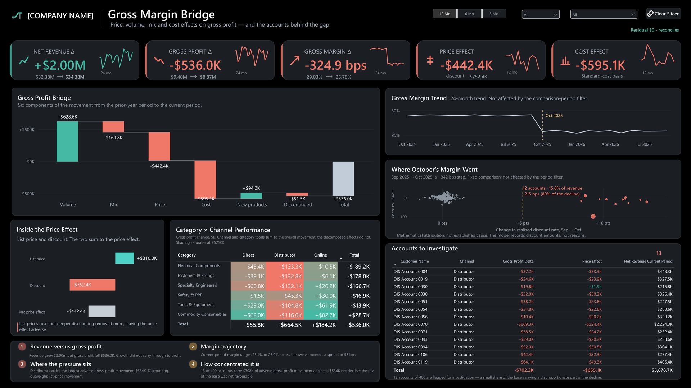

# 📉 Gross Margin Bridge

### Revenue grew $2.00m. Gross profit fell $536K. This report explains the gap — and names the 13 accounts behind it.



**[🔍 Full resolution](images/dashboard-full.png)** · Synthetic demonstration data · Power BI

---

## 🧩 The Problem

A sales report shows revenue up. A P&L shows profit down. **Neither tells a managing director which component moved, or where to start asking questions on Monday.**

Built for CEOs, CFOs and commercial directors of **$5–50m** distributors, wholesalers and multi-SKU ecommerce businesses.

---

## 📊 What It Answers

| Question | Answer on the page |
| --- | --- |
| How material is it? | **−$536.0K** profit · **−325 bps** margin · on **+$2.00M** revenue growth |
| A step or a slide? | One step at **Oct 2025**, then 12 months flat within **58 bps** |
| Which components? | Six-part bridge, residual **$0.00** |
| Price or discount? | List prices **rose $310.0K** · discounting **removed $752.4K** |
| Where? | **Distributor −$664.5K** vs **Online +$184.2K** |
| Who? | **13 of 400 accounts**, carrying **−$702.2K** |

---

## 🔬 The Bridge

A **symmetric midpoint (Bennet) decomposition** at SKU grain.

| Component | Effect |
| --- | --- |
| Volume | **+$628.6K** |
| Mix | **−$169.8K** |
| Price | **−$442.4K** |
| Cost | **−$595.1K** |
| New products | **+$94.2K** |
| Discontinued | **−$51.5K** |
| **Total** | **−$536.0K** — equals the actual change |

<details>
<summary><b>Why this method, and how product entry/exit is handled</b></summary>

<br>

**Why midpoint rather than Laspeyres or Paasche:** it is *symmetric* — reverse the two periods and every component negates exactly — and it allocates interaction effects between components instead of leaving a residual for the reader to interpret. With a base-period index, the arbitrary choice of base silently changes the answer.

**Product entry and exit:** the 300 SKUs partition into **255 comparable + 25 new + 20 discontinued** — disjoint and exhaustive. New and discontinued products are excluded from the volume index, so it measures trading volume rather than the arrival of products, and they carry their own bridge steps instead.

Every formula and sign convention: **[docs/METRIC_DEFINITIONS.md](docs/METRIC_DEFINITIONS.md)**

</details>

---

## 💡 Key Findings

- **📉 One step, not a slide.** 29.03% → 25.78%, with a **−342 bps** break between September and October 2025, then twelve months flat.
- **💰 Discounting, not list pricing.** List prices rose $310.0K; realised prices gave back $752.4K.
- **🎯 Highly concentrated.** 13 of 400 accounts carry **−$702.2K** against a **−$536.0K** net decline — the rest of the base was net favourable.
- **🌍 A Distributor problem, not a company-wide one.** Online grew profit **+$184.2K** while Distributor fell **−$664.5K**.

> **−325 bps** is the 12-month period-on-period margin change. **−342 bps** is the single-month September-to-October step. Different comparisons, both verified.

---

## 🔎 Where to Investigate Next

The dashboard identifies *where* to look. These are the questions it raises — not conclusions it can prove.

| Lead | What to check |
| --- | --- |
| **12 accounts doubled their discount rate in one month** | Who approved it, under what authority, and was it a contract renewal cycle or individual negotiation? |
| **The whole move lands in October 2025** | What changed that month — a price list, a rebate scheme, a salesperson, a competitor? |
| **Cost is the largest single component** | Is this real supplier inflation, or the annual standard-cost revision? Purchase-price data would settle it |
| **Online grew profit while Distributor fell** | What is Online doing differently on price realisation that Distributor is not? |

**None of this is answerable from sales data alone.** It needs pricing approvals, supplier invoices and commercial context — which is exactly the point of an investigation list rather than a recommendation.

---

## ⚠️ Limitations

- **🧪 Synthetic data.** Generated by `gmb_generate.py`, seed `20261010`. No figure describes a real business.
- **📦 Standard costs, not actual.** 250 of 300 SKUs had costs revised at the FY boundary. **A costing-assumption change and real supplier inflation are indistinguishable here.**
- **🔗 Mathematical attribution, not causation.** The bridge shows what moved, never why.
- **➗ Effects don't add across filters.** ΔGP is additive at every grain; the decomposed effects are not, because the volume index is recomputed per selection. Disclosed on the dashboard itself.
- **📅 One seasonal cycle.** 24 months contains a single September-to-October transition.

---

## ✅ Validation

The decomposition is computed **twice, by independent code paths** — Python (`gmb_bridge.py`) and DAX inside the report. Both harnesses were re-run against the published files on **19 October 2026**.

| | Result |
| --- | --- |
| **Bridge residual** | **$−0.000000** on the full population |
| **Property suite** (`gmb_final_gate.py`) | 40 checks — **37 pass, 0 fail**, 3 reported |
| **Dataset audit** (`gmb_audit.py`) | 87 checks — **81 pass, 2 fail**, 4 reported |
| **Frozen baseline** | **7,875** expected values · SHA-256 verified |

<details>
<summary><b>About the 2 failures — and why they were left failing</b></summary>

<br>

Both are checks on whether the generator produced the *intended* demonstration pattern. It produced a weaker version: concentration came out at **46.5%** against a 60% ± 10pp target, and **11 of 12** designed accounts landed in the top 12 rather than all 12.

**No data-integrity check failed.**

They were left failing rather than re-thresholded to pass. A test moved to fit its data is no longer a test.

Full detail, including five defects found and fixed during the build: **[docs/VALIDATION.md](docs/VALIDATION.md)**

</details>

---

## 🛠 Built With

**Power BI Desktop** · **DAX** (40+ measures) · **Power Query** · **Python** (pandas, numpy — independent validation)

---

## 📁 Repository

| Folder | Contents |
| --- | --- |
| **[powerbi/](powerbi/)** | The `.pbix` report, full DAX measure set, custom theme |
| **[images/](images/)** | Dashboard previews |
| **[data/](data/)** | 4 synthetic CSVs — 72,511 fact rows, 300 SKUs, 400 customers, 24 months |
| **[docs/](docs/)** | [Data dictionary](docs/DATA_DICTIONARY.md) · [Metric definitions](docs/METRIC_DEFINITIONS.md) · [Validation](docs/VALIDATION.md) · [Setup](docs/SETUP.md) |
| **[validation_pack/](validation_pack/)** | Frozen baseline + manifest with hashes |
| **[reports/](reports/)** | Audit output and run manifests |
| `gmb_*.py` | Generator, bridge engine, audit, property suite, reconciler |

---

## 🚀 How to Use

**Read it** — the image above and [`docs/`](docs/) contain the whole analysis. No software needed.

**Open it** — download [`powerbi/Gross-Margin-Bridge.pbix`](powerbi/), open in [Power BI Desktop](https://powerbi.microsoft.com/desktop/) (free). Data is embedded; no refresh or credentials.

**Verify it** — Python 3.11+, run from the repository root:

```bash
pip install pandas numpy
python gmb_audit.py run7-accepted    # prints the bridge at the end
python gmb_final_gate.py             # property suite
```

<details>
<summary><b>Expected output</b></summary>

<br>

```
BRIDGE  dGP -0.536m = volume +0.629 | mix -0.170 | price -0.442 | cost -0.595 | new +0.094 | disc -0.052   gamma 6.924%  residual $-0.000000
PRICE   list +0.310m, discount -0.752m
RAW     revenue $32.38m -> $34.38m (+6.18%), GM 29.03% -> 25.78% (-325 bps), GP $9.40m -> $8.87m
```

Regenerate the dataset: `python gmb_generate.py --seed 20261010 --run-label run7-accepted`. Change the seed and every figure above becomes wrong — the baseline is pinned by SHA-256.

Troubleshooting: **[docs/SETUP.md](docs/SETUP.md)**

</details>

*No public interactive demo — the dashboard is distributed as a `.pbix` and a static image.*

---

## 📜 Licence

**MIT** for code · **CC BY 4.0** for data and documentation. See [LICENSE](LICENSE). No font binary, icon set or third-party component is redistributed.

---

## 👤 Author

**Yisak Fikre** — Microsoft Certified Data Analyst · Power BI Developer

[](https://www.upwork.com/freelancers/~018f77b25aa92fd189?mp_source=share)
[](https://www.linkedin.com/in/yisak-fikre-b806361bb/)
[](https://github.com/yisakfikre)
[](mailto:yisakfikre@outlook.com)

**More:** [Sales Analysis Report](https://github.com/yisakfikre/Sales-Analytics-Report) · [Marketing Campaign Performance Report](https://github.com/yisakfikre/Marketing-Campaign-Performance-Report)
· [SaaS Growth and Unit Economics](https://github.com/yisakfikre/SaaS-Growth-and-Unit-Economics)
